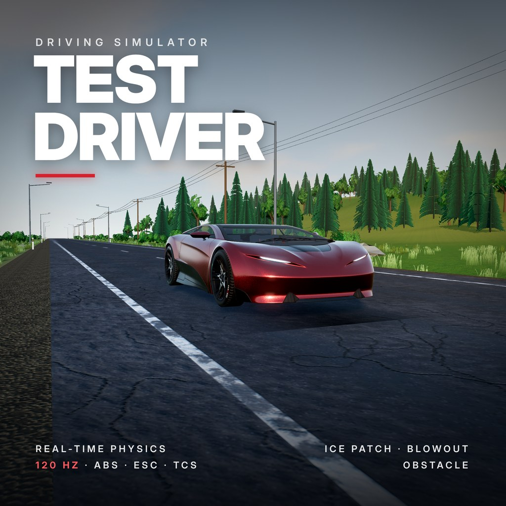

# Games

## Test Driver

Test Driver is a browser driving sim with realistic physics. At speed, the road turns to ice, a tyre blows out or cargo blocks your lane. Keep the car on the road, bring it back to a steady line and earn a score and medal. Snow, rain, night and a cockpit with working gauges.

- **Play:** open [`test-driver/index.html`](test-driver/index.html) in a desktop browser with WebGL 2 (Chrome, Edge, Firefox, Safari). An internet connection is needed on first start: three.js, lil-gui and the car model load from a CDN.
- **Manual:** [`test-driver/Test-Driver-Manual.pdf`](test-driver/Test-Driver-Manual.pdf)

### Controls

| Key | Action |
|---|---|
| W / S | Throttle / brake (hold S at a stop for reverse) |
| A / D | Steer |
| Space | Handbrake |
| C | Camera: Cockpit, Top, Chase |
| P / Esc | Pause |
| R | New run |
| 0 – 3 | Normal, ice patch, tyre blowout, obstacle |
| H | Telemetry panel |

Gamepads and steering wheels are supported. See the manual for details.

### Credits

Car model "Car Concept" by Eric Chadwick, Darmstadt Graphics Group GmbH, licensed under [CC BY 4.0](https://creativecommons.org/licenses/by/4.0/), from the [Khronos glTF Sample Assets](https://github.com/KhronosGroup/glTF-Sample-Assets). Built with [three.js](https://threejs.org) and [lil-gui](https://lil-gui.georgealways.com).
